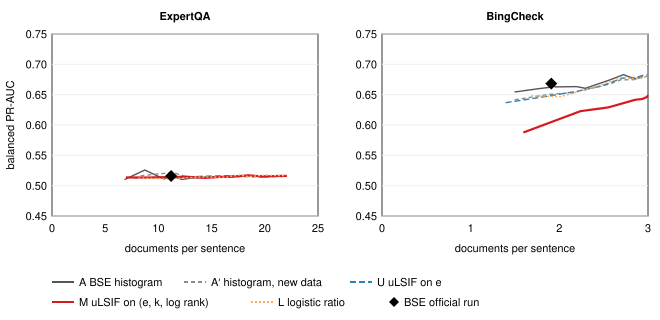

# Confirmatory test of multivariate DDRE — results summary

**Status: preregistered confirmatory test, run once.** The protocol is
[`docs/confirmatory_preregistration.md`](confirmatory_preregistration.md) with
Amendment 1 (sha256 `89dd2f64…`), fixed before any detector touched either
dataset. Every number here is read from the frozen artifacts in §9. All results
concern **hallucination-detection performance** and its computational cost, not
the factual accuracy of LLM output.

**Outcome: neither hypothesis is confirmed.**

- **H1 (lower cost at matched quality): not confirmed.** On BingCheck,
  M is worse than BSE.
- **H2 (better detection at matched cost): not confirmed.** On BingCheck,
  M is worse than BSE.
- **ExpertQA:** no difference from BSE, but BSE itself is barely above chance
  there.

The exploratory Factcheck-Bench result
([`docs/mddre_results_summary.md`](mddre_results_summary.md)) therefore does
not carry over to these two datasets.

---

## 1. What was run

The setup is the same as in the multivariate study.
- **Cells and estimators:** cells A, A′, U, M and L, with the frozen estimators
  (`486296a2…`), no refitting.
- **Stopping rule:** BSE's posterior band at CM 28 / CFA 96, [0.204, 0.769].
- **Curves:** the Amendment-1 curve of band scales 0.25 to 4.0.

| Dataset | Units | Hallucinated | Clusters | Documents per subclaim |
|---|---|---|---|---|
| ExpertQA (primary) | 11,389 sentences | 596 (5.2%) | 483 question authors | ≤ 5 released passages |
| BingCheck | 3,623 claims | 942 (26.0%) | 396 responses | ≤ 3 saved Bing pages |

**Features:**
- One float16 NLI pass covered 333,799 unique (subclaim, span) pairs, plus
  Wang's NBC pairs, for 334,195 cache rows.
- Gate F: before bulk scoring, all 396 distinct NBC pairs matched the earlier
  caches bit for bit.
- After scoring, no new pair overlapped the earlier caches (0 pairs checked).
  This is expected for new datasets, and it means gate F is the only
  bit-for-bit check on this run.

**Statistics:**
- A paired cluster bootstrap with 10,000 resamples, seed 42 and 95% percentile
  intervals.
- Holm's correction over the four primary tests.

## 2. Gates

| Gate | Check | Result |
|---|---|---|
| P | the preregistration, design, estimators and feature cache match their pins; the feature manifest is complete | passed |
| G0 | both loaders reproduce the preregistered totals | passed (table above) |
| F | the NBC pairs reproduce the earlier float16 caches | 396 / 396 exact |
| G1 | the engine reproduces the canonical SelfCheckGPT ablation predictions of cells A and D | 0 mismatches (1,525 sentences) |
| G2 | cell A under BSE's band uses exactly BSE's official documents | 0 mismatches, on every dataset and analysis |

## 3. Preregistered decision (§5)

- **E1, the net matched-quality saving:** D_A − D_M, in documents per
  sentence. D_A is the smaller of BSE's cost and the first crossing on A's
  curve.
- **E2, the matched-cost gain:** M's balanced PR-AUC at BSE's cost, minus
  BSE's.

| Test | BSE official (docs, PR-AUC) | Observed | 95% CI | Holm p (threshold) | Result |
|---|---|---|---|---|---|
| ExpertQA E1 | 11.20, 0.516 | −10.22 | [not reached, 0.86] | 0.415 (0.025) | not supported |
| ExpertQA E2 | | −0.002 | [−0.007, 0.005] | 0.582 (0.05) | not supported |
| BingCheck E1 | 1.91, 0.668 | not reached | not reached in 9,952 of 10,000 replicates | 0.000 (0.0125) | **M worse** |
| BingCheck E2 | | **−0.063** | [−0.080, −0.046] | 0.000 (0.0167) | **M worse** |

The statements produced by the preregistered rule are:

- E2: **not confirmed**, better detection at matched cost.
- E1: **not confirmed**, lower cost at matched quality.

On ExpertQA, M's E1 interval also reaches "not reached": M's curve never reaches
BSE's quality in 2,872 of 10,000 replicates.

## 4. Cost–quality curves

Generated by `scripts/plot_confirmatory_curves.py` from the frozen result. Both
panels use the same y-axis range.

- **ExpertQA.** Every cell's curve is flat at a balanced PR-AUC of
  0.51–0.53, against 0.50 for a constant score. No evidence model separates
  factual from hallucinated sentences on this data at any cost. E1's large
  negative value comes from where noise in these flat curves happens to cross
  BSE's level, not from a real cost difference.
- **BingCheck.** The curves of A, A′, U and L lie close together, between about
  0.64 and 0.68. M's curve lies below all of them at every cost and levels off
  at 0.647, even when all 3 pages are read. So M never reaches BSE's 0.668.

## 5. Descriptive analyses (no decision attached)

### 5.1 Every cell's matched-cost gain (E2)

| Cell | ExpertQA | BingCheck |
|---|---|---|
| A (BSE's curve) | +0.000 [−0.000, 0.000] | −0.000 [−0.001, 0.000] |
| A′ | +0.005 [−0.001, 0.012] | **−0.017 [−0.028, −0.006]** |
| U | −0.002 [−0.006, 0.003] | **−0.020 [−0.032, −0.007]** |
| M | −0.002 [−0.007, 0.005] | **−0.063 [−0.080, −0.046]** |
| L | **−0.005 [−0.009, −0.000]** | **−0.021 [−0.033, −0.008]** |

On BingCheck, every evidence model trained on the FActScore split has a lower
matched-cost gain than Wang's histogram, and M's is lowest.

### 5.2 Same band (operating point)

Under BSE's own band, every new cell reads more documents than BSE on both
datasets.

| Cell | ExpertQA: extra docs | BingCheck: extra docs | BingCheck: extra NLI calls |
|---|---|---|---|
| A′ | 4.29 | 0.66 | 3.59 |
| U | 3.22 | 0.56 | 3.05 |
| M | 3.20 | 0.94 | 5.12 |
| L | 5.22 | 0.80 | 4.33 |

At the same band, M's balanced PR-AUC minus BSE's is:
- ExpertQA: −0.003 [−0.008, 0.002].
- BingCheck: **−0.027 [−0.043, −0.010]**.

### 5.3 RQ3: the component chain (difference in E2)

| Step | ExpertQA | BingCheck |
|---|---|---|
| A → A′ (new training data) | +0.005 [−0.001, 0.012] | **−0.017 [−0.028, −0.006]** |
| A′ → U (uLSIF, normalised) | **−0.007 [−0.013, −0.002]** | −0.002 [−0.013, 0.008] |
| U → M (adds k and log rank) | +0.000 [−0.004, 0.005] | **−0.044 [−0.059, −0.028]** |
| L → M (uLSIF vs logistic, same features) | +0.003 [−0.002, 0.009] | **−0.042 [−0.056, −0.029]** |

On Factcheck-Bench, the U → M and L → M steps were where M gained
(+0.088 and +0.070). On BingCheck the same two steps are where it loses. These
are associations within this design, not isolated causes.

### 5.4 Sensitivity analyses (§6)

| Analysis | Units (hallucinated) | BSE PR-AUC | M's E2 | M's E1 |
|---|---|---|---|---|
| ExpertQA, Unsure as hallucinated | 12,494 (1,701) | 0.522 | −0.005 [−0.011, 0.000] | not reached in 7,434 of 10,000 |
| BingCheck, refuted only | 2,723 (42) | 0.534 | +0.034 [−0.014, 0.095] | +0.26 [−1.19, 0.29] |
| BingCheck, "not supported" as hallucinated | 3,840 (1,159) | 0.698 | **−0.067 [−0.083, −0.049]** | not reached in 9,960 of 10,000 |

Counting only BingCheck's 42 refuted claims as hallucinated is the one analysis
where M's point estimate is above BSE's. Its intervals include zero, and with
42 positives it was expected to be uninformative (preregistration §6).

### 5.5 ExpertQA by answering system (point estimates only)

| System | Sentences | Hallucinated | M's E2 | M's E1 |
|---|---|---|---|---|
| bing_chat | 2,025 | 110 | +0.010 | −0.11 |
| gpt4 (closed book) | 1,028 | 60 | −0.019 | not reached |
| post_hoc_gs_gpt4 | 2,298 | 93 | −0.005 | −8.14 |
| post_hoc_sphere_gpt4 | 2,164 | 123 | −0.013 | not reached |
| rr_gs_gpt4 | 2,274 | 101 | +0.008 | −0.17 |
| rr_sphere_gpt4 | 1,600 | 109 | +0.001 | −2.85 |

No system shows a consistent advantage for M.

## 6. What this means for the research questions

- **RQ1 (cost).** Not confirmed. At BSE's quality, M needs more documents than
  BSE on ExpertQA, and never reaches BSE's quality on BingCheck.
- **RQ2 (quality).** Not confirmed. At BSE's cost, M is no different from BSE
  on ExpertQA and has lower balanced PR-AUC on BingCheck.
- **RQ3 (components).** The features that went with M's gain on
  Factcheck-Bench (contradiction and rank, under uLSIF) go with its loss on
  BingCheck.
- **Taken together:**
  - Across five test sets, M was better than BSE on one (Factcheck-Bench,
    exploratory), no different on two (SelfCheckGPT, ExpertQA) and worse on
    two (FActScore test entities, BingCheck).
  - Estimators trained on FActScore biographies with BM25 Wikipedia passages do
    not transfer to Bing pages or to Google passages ranked by embeddings.

## 7. Limitations

- **ExpertQA has almost no signal for any cell.** BSE's balanced PR-AUC is 0.516
  against 0.50 for a constant score. A null there says little about M in
  particular.
- **Label semantics differ.**
  - ExpertQA has one expert annotator per sentence.
  - BingCheck labels measure support by the saved pages, from one crowd
    worker per claim, starting from LLM pre-labels.
- **Domain and retrieval shift** from the FActScore training split, stated in
  advance (§10).
- **Rank** means something different in each dataset: BM25 in training, OpenAI
  embedding order in ExpertQA, Bing order in BingCheck.
- **Equality checking.** No scored pair overlapped the earlier caches, so the
  post-scoring check compared nothing. Bit-for-bit reproducibility rests on
  gate F's 396 NBC pairs.
- **Cost** is counted in documents and NLI calls. Wall-clock time was not
  measured.

## 8. Run record

1. Features were scored from `5093d11`.
2. The replay ran once from `c00560a`, which merges PR #49, at
   2026-10-17T01:54Z.
3. Both outputs were written read-only.

## 9. Artifacts

All are under `~/ddre-artifacts/confirmatory/` and read-only.

| Artifact | sha256 |
|---|---|
| `confirmatory_features_float16.sqlite` | `5ad38eb54a343493aebeb7ec5e07075e006b3e037c158c5110ae21350b95348b` |
| `confirmatory_features_float16_manifest.json` | `4a562b14b945946bdab3ffe56d722fbc3d13c2309de3be053310a671a2aac354` |
| `confirmatory_replay_result_float16.json` | `6d1c23b2eb9746fbed7c93c9248827f0620f86b439243b8e9a798209926b8301` |
| `confirmatory_replay_predictions_float16.csv` | `6c7a7371fd587589e0e6ac951691ef00924c144c4c82a99126a99ffcadfbfcd1` |
| `docs/figures/confirmatory_cost_quality_curves.svg` | `449a4d1a2bada4b542dc0ce2c1347a85ae5a326456631b53cbef7ef1423ca3d3` |
