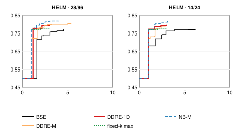

# Confirmatory test on HELM — results

**Status: preregistered confirmatory test, run once.**
- Protocol: [`docs/helm_preregistration.md`](helm_preregistration.md), merged
  before any detector, NLI model or retrieval touched HELM.
- The run was made from clean `main` (`f276c65`).
- Every number below is generated from the frozen result (§8).
- All results concern **hallucination-detection performance** and its
  computational cost.

**Outcome: both preregistered hypotheses are confirmed.**
- **H1:** DDRE-1D's cost–quality curve lies above BSE's, at both of Wang's
  cost settings.
- **H2:** DDRE-1D's curve lies above Wang's fixed-k maximum-entailment
  baseline, at both cost settings.

---

## 1. What ran

**Data:** HELM (Su et al., Findings of ACL 2024), release `3573342`.
- 3,736 sentences, 1,978 of them hallucinated.
- Seven generators.
- 229 Wikipedia articles, which are the bootstrap clusters.
- Each sentence is its own single subclaim.

**Evidence:**
- BM25 top-10 passages from the pinned enwiki-20230401 index; query = article
  title + sentence.
- Every sentence received 10 passages.
- NLI features come from one float16 pass (gate F: 396 / 396 NBC pairs
  exact).

**Methods:** frozen plan-v2 estimators, nothing refitted.
- BSE: Wang's histogram.
- DDRE-1D: uLSIF on entailment. Both are fitted on Wang's NBC pairs.
- Secondary: NB-M and DDRE-M.
- All are stopped by backward induction over every (K, C_retrieve) point,
  with K = 1…10 and C_retrieve ∈ {0.125, 0.25, 0.5, 1}, at C_M/C_FA 28/96
  and 14/24.
- Baselines: fixed-k max entailment for K = 1…10, and BSE-official (Wang's
  code rule) at the operating points.

**Statistics:**
- Primary endpoint: the AUC-gap between step envelopes of balanced AP against
  NLI calls per sentence.
- Paired cluster bootstrap over articles: 10,000 replicates, seed 42.
- Holm over the four one-sided tests.

**Gates (all passed):**
- P: pins.
- G0: totals.
- X2 and X4: the engine reproduces the SelfCheckGPT references row for row.

## 2. Preregistered decision

| Test | Comparison | C_M/C_FA | AUC-gap | 5th pct. | One-sided p | Holm threshold | Result |
|---|---|---|---|---|---|---|---|
| H1a | DDRE-1D vs BSE | 28/96 | +0.0429 | +0.0361 | < 1e-04 | 0.0125 | **supported** |
| H1b | DDRE-1D vs BSE | 14/24 | +0.0373 | +0.0300 | < 1e-04 | 0.0167 | **supported** |
| H2a | DDRE-1D vs fixed-k max | 28/96 | +0.0082 | +0.0023 | 0.0121 | 0.0500 | **supported** |
| H2b | DDRE-1D vs fixed-k max | 14/24 | +0.0161 | +0.0095 | < 1e-04 | 0.0250 | **supported** |

"Supported" means Holm rejects and the 5th percentile of the replicates is
above 0 (preregistration §5). No replicate was undefined.

**Statements produced by the preregistered rule:**
- H1: **confirmed**, DDRE-1D's cost–quality curve lies above BSE's.
- H2: **confirmed**, DDRE-1D's cost–quality curve lies above fixed-k max
  entailment's.

## 3. Envelopes

Generated by `scripts/plot_helm_curves.py` from the frozen result.

## 4. Secondary endpoints (descriptive, 95% intervals)

| Comparison | C_M/C_FA | AUC-gap | E-quality (AP at reference cost) | E-cost (NLI calls saved at reference AP) |
|---|---|---|---|---|
| DDRE-1D vs BSE | 28/96 | +0.043 [+0.035, +0.053] | +0.024 [+0.016, +0.036] | +2.68 [+1.86, +3.49] |
| DDRE-1D vs BSE | 14/24 | +0.037 [+0.029, +0.046] | +0.035 [+0.025, +0.046] | +1.43 [+0.72, +1.48] |
| DDRE-1D vs fixed-k max | 28/96 | +0.008 [+0.001, +0.016] | +0.017 [+0.009, +0.027] | -0.16 [-0.18, +1.83] (n.r. 3%) |
| DDRE-1D vs fixed-k max | 14/24 | +0.016 [+0.008, +0.023] | +0.019 [+0.009, +0.029] | +0.00 [+0.00, +1.00] (n.r. 0%) |
| DDRE-M vs NB-M | 28/96 | -0.024 [-0.034, -0.016] | -0.018 [-0.029, -0.010] | -3.41 [-3.47, -0.50] (n.r. 44%) |
| DDRE-M vs NB-M | 14/24 | -0.033 [-0.042, -0.021] | -0.026 [-0.036, -0.015] | -0.29 [-1.40, -0.10] (n.r. 3%) |
| BSE vs fixed-k max | 28/96 | -0.041 [-0.052, -0.031] | -0.007 [-0.019, +0.003] | -2.85 [-3.64, -1.65] (n.r. 0%) |
| BSE vs fixed-k max | 14/24 | -0.028 [-0.038, -0.018] | -0.016 [-0.028, -0.006] | -1.43 [-1.48, -0.72] |
| NB-M vs fixed-k max | 28/96 | +0.035 [+0.024, +0.047] | +0.040 [+0.027, +0.053] | not reached [+0.21, +3.47] (n.r. 100%) |
| NB-M vs fixed-k max | 14/24 | +0.033 [+0.021, +0.044] | +0.034 [+0.021, +0.048] | +0.39 [-0.62, +2.39] (n.r. 25%) |
| DDRE-M vs fixed-k max | 28/96 | +0.009 [-0.001, +0.017] | +0.016 [+0.001, +0.027] | not reached [-1.15, +2.09] (n.r. 60%) |
| DDRE-M vs fixed-k max | 14/24 | -0.005 [-0.013, +0.005] | -0.039 [-0.049, -0.026] | -0.29 [-0.31, -0.16] |

**G1 (cost):** DDRE-1D reaches BSE's balanced AP with fewer NLI calls per
sentence:
- 2.68 fewer at 28/96 (interval [1.86, 3.49]);
- 1.43 fewer at 14/24 ([0.72, 1.48]).

**G2 (detection):** at BSE's cost, DDRE-1D's AP is higher:
- +0.024 at 28/96 ([0.016, 0.036]);
- +0.035 at 14/24 ([0.025, 0.046]).

## 5. Operating points (K = 10, C_retrieve = 1)

| Method | C_M/C_FA | Balanced AP | Nonfactual PR-AUC | Factual PR-AUC | Accuracy | Docs/sent | NLI/sent | Brier | ECE | Pearson | Spearman |
|---|---|---|---|---|---|---|---|---|---|---|---|
| BSE | 28/96 | 0.762 | 0.760 | 0.761 | 0.744 | 5.46 | 5.46 | 0.233 | 0.189 | 0.538 | 0.547 |
| BSE | 14/24 | 0.721 | 0.691 | 0.738 | 0.742 | 3.42 | 3.42 | 0.211 | 0.135 | 0.533 | 0.498 |
| DDRE-1D | 28/96 | 0.766 | 0.767 | 0.763 | 0.752 | 5.87 | 5.87 | 0.213 | 0.164 | 0.564 | 0.563 |
| DDRE-1D | 14/24 | 0.757 | 0.744 | 0.770 | 0.754 | 3.91 | 3.91 | 0.198 | 0.120 | 0.561 | 0.558 |
| NB-M | 28/96 | 0.804 | 0.812 | 0.789 | 0.770 | 4.68 | 4.68 | 0.196 | 0.158 | 0.605 | 0.609 |
| NB-M | 14/24 | 0.775 | 0.766 | 0.786 | 0.765 | 2.71 | 2.71 | 0.184 | 0.096 | 0.586 | 0.577 |
| DDRE-M | 28/96 | 0.782 | 0.784 | 0.779 | 0.755 | 2.44 | 2.44 | 0.217 | 0.192 | 0.567 | 0.566 |
| DDRE-M | 14/24 | 0.731 | 0.707 | 0.754 | 0.730 | 1.30 | 1.30 | 0.219 | 0.171 | 0.533 | 0.522 |
| BSE-official | 28/96 | 0.736 | 0.710 | 0.752 | 0.736 | 2.98 | 2.98 | 0.205 | 0.114 | 0.523 | 0.520 |
| BSE-official | 14/24 | 0.734 | 0.682 | 0.762 | 0.728 | 1.62 | 1.62 | 0.192 | 0.059 | 0.519 | 0.531 |

**At the operating point itself, DDRE-1D is not cheaper than BSE:**
- It reads slightly more: 5.87 vs 5.46 NLI calls at 28/96, and 3.91 vs
  3.42 at 14/24.
- Its AP is higher: 0.766 vs 0.762, and 0.757 vs 0.721.
- So its advantage is across the curve: it reaches any given quality more
  cheaply.

**G3 (calibration):** DDRE-1D's Brier score is lower than BSE's at both
operating points (0.213 vs 0.233, and 0.198 vs 0.211). These are observed
values; no interval was computed for them.

**Passage level:** Pearson and Spearman are computed over generator × article
groups.

## 6. Sensitivity analyses (preregistration §6)

| Analysis | H1a | H1b | H2a | H2b | Statements |
|---|---|---|---|---|---|
| six generators | +0.0433 (5th +0.0356) ✓ | +0.0374 (5th +0.0300) ✓ | +0.0047 (5th -0.0012) | +0.0124 (5th +0.0066) ✓ | H1: confirmed: DDRE-1D's cost-quality curve lies above BSE's; H2: partial support at C_M/C_FA 14/24: DDRE-1D's curve lies above fixed-k max entailment's |
| source article excluded | +0.0375 (5th +0.0307) ✓ | +0.0316 (5th +0.0255) ✓ | +0.0158 (5th +0.0092) ✓ | +0.0215 (5th +0.0154) ✓ | H1: confirmed: DDRE-1D's cost-quality curve lies above BSE's; H2: confirmed: DDRE-1D's cost-quality curve lies above fixed-k max entailment's |

- **H1 holds in every sensitivity analysis:**
  - six generators (the paper's set, without mpt7b; 3,197 units);
  - source article excluded (8,395 of 37,360 passages removed; ranks
    renumbered).
- **H2 is weaker:**
  - It is supported with the source article excluded.
  - It is only partially supported on the six-generator subset: the 28/96
    test is not supported there (AUC-gap +0.005, 5th percentile −0.001).

## 7. Per generator (observed AUC-gaps, descriptive)

| Generator | Units | Hallucinated | vs BSE 28/96 | vs BSE 14/24 | vs fixed-k 28/96 | vs fixed-k 14/24 |
|---|---|---|---|---|---|---|
| falcon40b | 521 | 261 | +0.0344 | +0.0314 | +0.0048 | +0.0139 |
| gptj7b | 572 | 400 | +0.0485 | +0.0425 | +0.0087 | +0.0186 |
| llamabase7b | 565 | 322 | +0.0360 | +0.0344 | -0.0006 | +0.0140 |
| llamachat13b | 476 | 147 | +0.0321 | +0.0257 | +0.0112 | +0.0189 |
| llamachat7b | 497 | 189 | +0.0450 | +0.0363 | +0.0213 | +0.0214 |
| mpt7b | 539 | 274 | +0.0507 | +0.0422 | +0.0288 | +0.0330 |
| opt7b | 566 | 385 | +0.0384 | +0.0314 | -0.0074 | +0.0081 |

- **DDRE-1D vs BSE:** positive for all seven generators at both cost
  settings (+0.026 to +0.051).
- **DDRE-1D vs fixed-k:** positive for five of seven generators at 28/96, and
  for all seven at 14/24.

## 8. Secondary findings and limitations

**Findings outside the decision:**
- **The retriever-aware version is not supported.** DDRE-M lies below its
  histogram control NB-M (AUC-gap −0.024 and −0.033), as in the exploratory
  study.
- **NB-M** has the highest balanced AP of any method on HELM (0.804 at
  28/96).
- **BSE lies below the fixed-k baseline** (AUC-gap −0.041 and −0.028).

**Limitations:**
- **Effect sizes are modest:** +0.04 AP across the curve against BSE, and
  +0.01 to +0.02 against fixed-k.
- **H2 at 28/96 is the narrowest result:** p = 0.012 against a Holm threshold
  of 0.05, and not supported on the six-generator subset.
- **Protocol differences from Wang:**
  - our own Wikipedia retrieval, not live Bing;
  - no claim decomposition;
  - HELM labels also drew on Google;
  - the mapping of "Unverifiable" to the binary label is undocumented;
  - the released counts differ from the paper's. The authors were asked on
    2026-10-17 and had not replied at the time of writing.
- **Licence:** HELM states none. The authors were asked; the data are used
  for research only and are not redistributed.

## 9. Run record and artifacts

The run was made from `f276c65`. All artifacts below are read-only.

| Artifact | sha256 |
|---|---|
| `~/ddre-artifacts/confirmatory-v2/helm/helm_evidence_top10.jsonl` | `c86f405a331788c160e02f7448b2543e58144fd1cb9f810dd59a07cc7a3fb9c0` |
| `~/ddre-artifacts/confirmatory-v2/helm/helm_features_float16.sqlite` | `a02ef22579c80dc661e0fef296a3ef4af695467e5cf548171e23a09c35d9a54d` |
| `~/ddre-artifacts/confirmatory-v2/helm/helm_confirmatory_result_float16.json` | `10bbd7306d3710fb4da076d94ebd98df20f624ff7d974a245c49e0639e448151` |
| `~/ddre-artifacts/confirmatory-v2/helm/helm_confirmatory_predictions_float16.csv` | `994d85f223b45eaa0afe5740ea5cd98e72f8193d05c50266935dd79302d7a8e8` |
| `docs/figures/helm_envelopes.svg` | `64bdec0255a043eca0924effd2af1ba8a2f059a625248b92e2338418cd40a2ea` |
