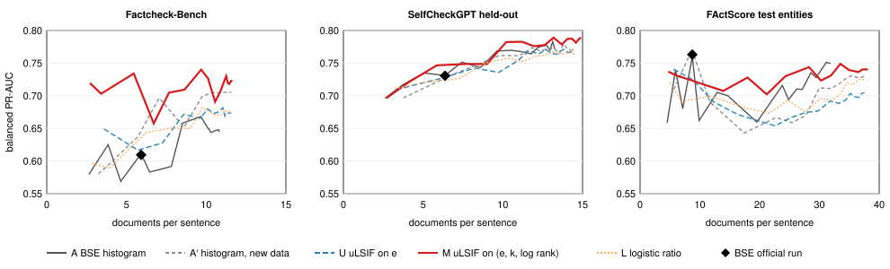

# Multivariate DDRE — results summary

**Status: exploratory.** The study was preregistered in
[`docs/multivariate_ddre_design.md`](multivariate_ddre_design.md). Design
**Amendment 1** (§11) replaced the cost–quality curve after the first replay's
results had been seen. So RQ1, RQ2 and the RQ3 chain are exploratory on every
test set, and Factcheck-Bench is no longer a confirmatory test for them. §7's
thresholds are still applied and reported below.

Every number here is read from the frozen artifacts listed in §9. Each step ran
once, from clean `main`. All results concern **hallucination-detection
performance** and its computational cost. None of them concerns the factual
accuracy of the text an LLM generates.

---

## 1. What was run

| Cell | Evidence per retrieved document | Fit on |
|---|---|---|
| **A** | BSE's NBC histogram of max entailment e (Wang's histogram) | Wang's NBC data |
| **A′** | the same 10-bin histogram of e | the new training split |
| **U** | self-normalised uLSIF density ratio on e | the new training split |
| **M** | self-normalised uLSIF density ratio on (e, k, log rank) | the new training split |
| **L** | logistic-regression density ratio on (e, k, log rank) | the new training split |

Here e is max entailment, k is max contradiction (both 0–100), and rank is the
document's retrieval rank.

- **Stopping rule.** Every cell stops on a posterior band.
  - The operating point is BSE's own band at CM 28 / CFA 96, [0.204, 0.769].
    Cell A under this band uses exactly BSE's documents (gate G2).
  - **BSE official** means cell A under BSE's own look-ahead rule, as Wang
    runs it.
- **Training data.** The entity-disjoint FActScore split (design §4): 91
  entities, 1,870 sentences, 7,382 facts. That gives 52,360 documents for
  factual claims and 21,460 for hallucinated claims.
- **Hyperparameters.** These come only from each estimator's own
  cross-validation; no test set was read.
  - U: σ = 0.394 and λ = 0.01.
  - M: σ = 1.093 and λ = 0.1.
  - L: C = 0.046.
  - For both U and M, σ is the **smallest value on the fixed grid** (§8).
- **Test sets.**

  | Test set | Sentences | Clusters | Documents per subclaim | Preregistered role |
  |---|---|---|---|---|
  | Factcheck-Bench | 271 | 92 responses | ≤ 5 | confirmatory |
  | SelfCheckGPT held-out | 1,525 | 190 passages | ≤ 10 | replication |
  | FActScore test entities | 1,260 | 86 entities | ≤ 10 | replication |

- **Features.** One NLI pass in float16 covered all 186,354 unique
  (claim, passage-span) pairs. Before bulk scoring, all 396 NBC pairs matched
  the earlier caches exactly. After it, all 164,685 overlapping pairs matched,
  with 0 mismatches. The float32 Gate 1 check matched float16 to about 0.001
  on every metric, so §10.4 selected float16.
- **Statistics.** A paired cluster bootstrap across all cells, with 10,000
  resamples, seed 42 and 95% percentile intervals.

## 2. Gates

| Gate | Check | Result |
|---|---|---|
| G1 | the engine reproduces the canonical ablation predictions of cells A and D (SelfCheckGPT held-out, 1,525 sentences) | 0 mismatches |
| G2 | cell A under BSE's band uses BSE's official documents, on every test set | 0 mismatches |
| G3 | the amended run reproduces every operating-point row of the frozen first replay | 0 mismatches |

## 3. The first replay's curve endpoints are void

The first replay (`19415ca`, result `927e0a2d…`) reported RQ1 and RQ2 as
supported on Factcheck-Bench. That came from the curve design, not the
detectors. The preregistered sweep used symmetric bands around the decision
threshold t = logit(28/124). For half-widths 0.25–1.0, those bands lie
entirely below P0 = 0.5. A detector under such a band reads no document and
gives every sentence P = 0.5. Wang's PR-AUC then scores exactly 0.75, which is
higher than every real detector on Factcheck-Bench. Amendment 1 instead scales
BSE's band in log-odds about P0 by 0.25 to 4.0. Every band then contains P0,
and scale 1 is the operating point. Results at BSE's band (§6) never used the
curve, and gate G3 confirms they are unchanged.

## 4. RQ1 and RQ2: M against BSE (exploratory)

- **RQ1** is the matched-quality saving: BSE's documents per sentence minus
  M's, at BSE's balanced PR-AUC.
- **RQ2** is the matched-cost gain: M's balanced PR-AUC minus BSE's, at BSE's
  documents per sentence.

Both are interpolated on M's curve.

| Test set | BSE official (docs, PR-AUC) | RQ1 saving [95% CI] | RQ2 gain [95% CI] | §7 thresholds |
|---|---|---|---|---|
| **Factcheck-Bench** | 5.92, 0.609 | **3.21 [2.90, 3.55]** | **+0.096 [0.037, 0.158]** | both met |
| SelfCheckGPT held-out | 6.37, 0.731 | 1.61 [−2.98, 3.54] | +0.017 [−0.012, 0.045] | neither |
| FActScore test entities | 8.74, 0.763 | not reached in 73% of replicates | **−0.040 [−0.072, −0.010]** | neither; M is lower |

On Factcheck-Bench, M reaches BSE's balanced PR-AUC at 2.7 documents per
sentence instead of 5.92, and scores higher at matched cost. Neither result
appears on the other two test sets. On FActScore test entities, M's matched-cost
quality is lower than BSE's.

## 5. Cost–quality curves

Each line is one cell's curve, for band scales 0.25 to 4.0. The diamond is
BSE's official run. Generated by `scripts/plot_mddre_curves.py` from the frozen
amended result.

What the figure shows:

- **Factcheck-Bench.** M's curve is above every other cell's at nearly every
  cost. BSE's own curve (A) varies by up to ±0.05 between neighbouring band
  scales.
- **SelfCheckGPT held-out.** All five curves lie within a few hundredths of
  each other. Above about 10 documents per sentence, M is highest or tied.
- **FActScore test entities.** BSE's official run sits above A's neighbouring
  curve points: 0.763, against 0.680 at scale 0.75 and 0.662 at scale 1.25.
  Between about 10 and 30 documents per sentence, M's curve is mostly above
  A's. The matched endpoints are anchored at the official run, so the negative
  RQ2 value is measured against this single point.

## 6. Same-band differences (operating point)

Each cell runs under BSE's own band. The table gives the cell's value minus BSE
official, so a negative documents value means the cell reads more documents.

| Cell | Factcheck-Bench Δdocs | ΔPR-AUC | SelfCheckGPT Δdocs | ΔPR-AUC | FActScore Δdocs | ΔPR-AUC |
|---|---|---|---|---|---|---|
| A′ | −2.69 | +0.042 [−0.010, 0.092] | −3.41 | **+0.031 [0.004, 0.058]** | −8.70 | **−0.120 [−0.156, −0.085]** |
| U | −2.67 | **+0.062 [0.006, 0.114]** | −3.36 | +0.005 [−0.025, 0.038] | −7.58 | **−0.092 [−0.125, −0.058]** |
| M | −0.79 | +0.048 [−0.012, 0.112] | −1.36 | +0.018 [−0.010, 0.046] | −9.22 | **−0.035 [−0.068, −0.004]** |
| L | −1.92 | +0.041 [−0.011, 0.094] | −2.57 | +0.020 [−0.006, 0.045] | −9.55 | **−0.083 [−0.120, −0.047]** |

Every documents difference has a CI below zero. **At BSE's own band, every new
cell reads more documents than BSE on every test set.**

Cell A against BSE official uses the same documents on every set (+0.000), so
its PR-AUC difference should be zero. It is +0.002, +0.000 and −0.003. The two
update paths differ in the last floating-point digits of P (visible in the
predictions file), which reorders tied scores. Differences of this size, about
±0.003 at the point estimate and up to ±0.01 within the Factcheck-Bench CI,
are treated as noise.

## 7. RQ3: the component chain (exploratory, descriptive)

Each row gives the difference in matched-cost gain between the two cells, with
a 95% CI.

| Step | Factcheck-Bench | SelfCheckGPT held-out | FActScore test entities |
|---|---|---|---|
| A → A′ (new training data) | +0.035 [−0.010, 0.078] | −0.004 [−0.027, 0.019] | +0.009 [−0.019, 0.035] |
| A′ → U (uLSIF, normalised) | −0.028 [−0.069, 0.019] | +0.001 [−0.018, 0.021] | **−0.044 [−0.067, −0.018]** |
| U → M (adds k and log rank) | **+0.088 [0.036, 0.143]** | +0.019 [−0.007, 0.045] | −0.002 [−0.034, 0.029] |
| L → M (uLSIF vs logistic, same features) | **+0.070 [0.007, 0.133]** | **+0.023 [0.001, 0.046]** | +0.029 [−0.004, 0.059] |

On Factcheck-Bench, the difference between M and BSE goes with adding k and
log rank to e, and with using uLSIF rather than a logistic ratio on the same
features. More training data and normalisation show no consistent difference.
These are associations within this design. They do not isolate a cause.

## 8. Limitations

- **Exploratory.** The curve was amended after the results were seen.
  Confirming the Factcheck-Bench result needs a test set no analysis has
  touched.
- **Factcheck-Bench is small.** It has 271 sentences in 92 responses, with at
  most 5 documents per subclaim, so its intervals are wide.
- **The result does not replicate.** It is absent on SelfCheckGPT held-out and
  reversed at BSE's operating point on FActScore test entities, the domain the
  estimators were trained on.
- **The RQ1 saving is optimistic on noisy curves.** It takes the first band
  scale at which a curve reaches BSE's quality. Under the same rule, BSE's own
  curve (A) "saves" 2.48 documents on Factcheck-Bench (CI [−2.00, 3.44]) and
  1.63 on SelfCheckGPT (CI [0.002, 3.14]). M's RQ1 saving should be read
  against these values. The RQ2 gain is the less noise-sensitive endpoint.
- **Grid edge.** Cross-validation chose the smallest σ on the fixed grid for
  both U and M. A narrower kernel was not tried.
- **Tie noise** of about ±0.003 balanced PR-AUC at the point estimate (§6).
- **Cost** is counted in documents and NLI calls. Wall-clock time was not
  measured.

## 9. Artifacts

All are under `~/ddre-artifacts/` and read-only.

| Artifact | sha256 |
|---|---|
| `mddre/mddre_features_float16.sqlite` | `47a0425fcd90944f47331c2dad8900fe8c05d8bd03eb4d4ca0f5d70b7e097353` |
| `mddre/mddre_features_float16_manifest.json` | `32271a5584f53aa7be385f2da40899a27e14b6c23e8f5aaaed385eaca92518d9` |
| `mddre/mddre_estimators_float16.json` | `486296a2717b95a4ba661f15fbff8286613f7eeba508dab804614fa98d624014` |
| `mddre/mddre_replay_result_float16.json` (first replay; curve endpoints void) | `927e0a2d2388efa37147f2d4b4da7f9e533db55f2571275ca4abb23862541544` |
| `mddre/mddre_replay_predictions_float16.csv` | `c874d05f7bab41dfe0c033eb36ce2fb0f5648a452348e6ac5e30aee22526423a` |
| `mddre/mddre_replay_result_float16_amendment1.json` | `ee531d9fc11f0a52ea5072f0aa6e544e2753d4582194617f61380a3227cb41b5` |
| `mddre/mddre_replay_predictions_float16_amendment1.csv` (identical to the first replay's) | `c874d05f7bab41dfe0c033eb36ce2fb0f5648a452348e6ac5e30aee22526423a` |
| `precision-fp32/wang_reproduction_fp32_mps.json` (float32 Gate 1 check) | `dee27c197a98eaa9b747607ccb334501b3b264dd5dfb4593d1054a33ae8aba04` |
| `docs/figures/mddre_cost_quality_curves.svg` | `801ff71adc8c8bd787ed34042276f60c4bef68141b45fd97fcaf41ba53d6bda1` |

The amended replay ran from `2b05add` at 2026-10-16T07:32Z.
