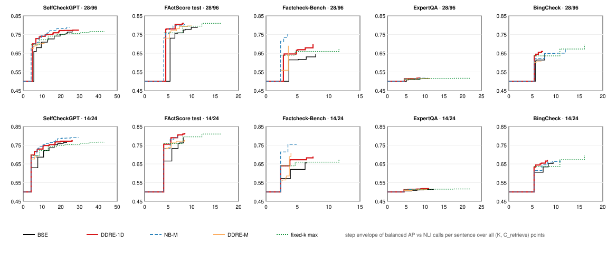

# Plan v2 amendment 2 — budget-knob results (exploratory)

**Status: exploratory.** Amendment 2
([`docs/research_plan_v2.md`](research_plan_v2.md) §11) was written after
Phase 5's results had been seen. Every dataset had also been used before
plan v2. Nothing here is confirmatory. The run was made once, from clean
`main` (`973bbeb`). The tables are generated from the frozen result (§6).

---

## 1. What ran

- **Methods:** BSE, DDRE-1D, NB-M and DDRE-M under backward induction.
- **Operating points:** every combination of K (maximum documents per
  subclaim, from 1 to the dataset's maximum) and C_retrieve ∈ {0.125, 0.25,
  0.5, 1}, at C_M/C_FA 28/96 and 14/24.
- **Baseline:** Wang's fixed-k maximum-entailment baseline, K = 1 to the
  maximum.
- **Curves:** each curve is the step envelope over all of a method's points.
  The point (K = maximum, C_retrieve = 1) is Phase 5's operating point.
- **Gates:**
  - X0: pins.
  - X2: BSE-official reproduces the frozen replays.
  - X4: the operating points reproduce Phase 5 exactly.

  All passed on all five datasets.
- **Statistics:** paired cluster bootstrap, 10,000 replicates, seed 42.
  **Bold** marks a 95% interval that excludes 0 with no not-reached
  replicates.
- **Endpoints:**
  - **AUC-gap:** the mean AP difference over the shared cost range.
  - **E-quality:** the AP gain at the anchor's NLI cost.
  - **E-cost:** the NLI calls saved at the anchor's AP.

## 2. Envelopes

Generated by `scripts/plot_v2_budget.py` from the frozen result.

The K knob fills the middle budgets that Phase 5's C_retrieve sweep missed.
The flat start at AP 0.5 is real: with K = 1, backward induction is the
one-step Eq. 8, which reads nothing at these costs.

## 3. Contrasts

#### DDRE-1D vs BSE (anchor: reference's operating point)

| Dataset | C_M/C_FA | AUC-gap | E-quality | E-cost (NLI calls) |
|---|---|---|---|---|
| SelfCheckGPT | 28/96 | **+0.023 [+0.017, +0.031]** | +0.001 [-0.007, +0.020] | +7.45 [+0.96, +13.40] (n.r. 0%) |
| SelfCheckGPT | 14/24 | **+0.020 [+0.013, +0.028]** | +0.006 [-0.009, +0.019] | +4.60 [-4.64, +9.88] (n.r. 3%) |
| FActScore test | 28/96 | **+0.031 [+0.020, +0.043]** | **+0.020 [+0.007, +0.035]** | +4.14 [+1.66, +6.34] (n.r. 0%) |
| FActScore test | 14/24 | **+0.026 [+0.015, +0.036]** | **+0.021 [+0.007, +0.036]** | **+1.87 [+1.43, +4.43]** |
| Factcheck-Bench | 28/96 | **+0.041 [+0.009, +0.077]** | +0.053 [-0.002, +0.106] | +5.03 [+0.35, +5.63] (n.r. 3%) |
| Factcheck-Bench | 14/24 | **+0.035 [+0.003, +0.071]** | +0.025 [-0.015, +0.066] | +2.71 [-1.31, +4.40] (n.r. 2%) |
| ExpertQA | 28/96 | **+0.003 [+0.002, +0.006]** | +0.003 [-0.001, +0.009] | +4.83 [+0.81, +6.46] (n.r. 4%) |
| ExpertQA | 14/24 | **+0.004 [+0.002, +0.007]** | **+0.004 [+0.001, +0.010]** | **+4.18 [+1.70, +5.78]** |
| BingCheck | 28/96 | **+0.012 [+0.010, +0.015]** | **+0.031 [+0.022, +0.040]** | **+0.40 [+0.31, +0.47]** |
| BingCheck | 14/24 | **+0.013 [+0.010, +0.016]** | **+0.019 [+0.011, +0.027]** | **+1.48 [+0.54, +2.78]** |

#### DDRE-M vs NB-M (anchor: reference's operating point)

| Dataset | C_M/C_FA | AUC-gap | E-quality | E-cost (NLI calls) |
|---|---|---|---|---|
| SelfCheckGPT | 28/96 | **-0.056 [-0.077, -0.031]** | **-0.085 [-0.109, -0.057]** | not reached (n.r. 100%) |
| SelfCheckGPT | 14/24 | **-0.055 [-0.078, -0.031]** | **-0.082 [-0.108, -0.053]** | not reached (n.r. 100%) |
| FActScore test | 28/96 | -0.010 [-0.028, +0.008] | -0.008 [-0.027, +0.010] | -0.32 [-2.20, +0.36] (n.r. 0%) |
| FActScore test | 14/24 | -0.020 [-0.041, +0.000] | **-0.028 [-0.047, -0.004]** | -0.21 [-3.15, +1.41] (n.r. 8%) |
| Factcheck-Bench | 28/96 | **-0.090 [-0.127, -0.048]** | **-0.062 [-0.101, -0.020]** | not reached [-4.46, -0.10] (n.r. 95%) |
| Factcheck-Bench | 14/24 | **-0.092 [-0.132, -0.049]** | **-0.047 [-0.087, -0.012]** | not reached [-2.18, +0.07] (n.r. 90%) |
| ExpertQA | 28/96 | -0.002 [-0.005, +0.001] | -0.003 [-0.007, +0.002] | -3.97 [-4.71, +2.05] (n.r. 27%) |
| ExpertQA | 14/24 | **-0.004 [-0.008, -0.001]** | **-0.005 [-0.009, -0.001]** | not reached [-3.63, +2.20] (n.r. 98%) |
| BingCheck | 28/96 | **-0.031 [-0.043, -0.016]** | not reached (n.r. 100%) | **-5.37 [-5.56, -5.19]** |
| BingCheck | 14/24 | **-0.043 [-0.056, -0.028]** | **-0.044 [-0.059, -0.028]** | not reached (n.r. 100%) |

#### BSE vs fixed-max (anchor: method's operating point)

| Dataset | C_M/C_FA | AUC-gap | E-quality | E-cost (NLI calls) | fixed-k never reaches |
|---|---|---|---|---|---|
| SelfCheckGPT | 28/96 | **-0.012 [-0.024, -0.002]** | **+0.017 [+0.000, +0.033]** | +7.26 [-9.62, +17.86] (n.r. 13%) | 0 (obs.) |
| SelfCheckGPT | 14/24 | -0.004 [-0.016, +0.007] | +0.016 [-0.004, +0.035] | +13.50 [-5.57, +21.98] (n.r. 30%) | 0 (obs.) |
| FActScore test | 28/96 | **-0.033 [-0.046, -0.017]** | **-0.019 [-0.033, -0.000]** | -0.50 [-4.72, +2.34] (n.r. 0%) | 0 (obs.) |
| FActScore test | 14/24 | **-0.022 [-0.032, -0.008]** | -0.002 [-0.021, +0.017] | +0.66 [-4.46, +1.17] | 0 (obs.) |
| Factcheck-Bench | 28/96 | **-0.059 [-0.117, -0.009]** | -0.014 [-0.079, +0.035] | -3.27 [-6.14, +3.93] (n.r. 10%) | 0 (obs.) |
| Factcheck-Bench | 14/24 | -0.031 [-0.081, +0.013] | -0.003 [-0.047, +0.040] | -1.86 [-4.42, +5.55] (n.r. 12%) | 0 (obs.) |
| ExpertQA | 28/96 | -0.003 [-0.008, +0.000] | -0.001 [-0.005, +0.004] | -2.05 [-6.51, +11.14] (n.r. 12%) | 0 (obs.) |
| ExpertQA | 14/24 | **-0.003 [-0.008, -0.000]** | -0.001 [-0.006, +0.003] | -0.76 [-5.67, +3.70] (n.r. 0%) | 0 (obs.) |
| BingCheck | 28/96 | **-0.036 [-0.047, -0.026]** | **-0.022 [-0.034, -0.011]** | **-0.44 [-0.51, -0.34]** | 0 (obs.) |
| BingCheck | 14/24 | **-0.011 [-0.021, -0.002]** | **+0.016 [+0.002, +0.031]** | **+2.47 [+2.20, +2.70]** | 0 (obs.) |

#### DDRE-1D vs fixed-max (anchor: method's operating point)

| Dataset | C_M/C_FA | AUC-gap | E-quality | E-cost (NLI calls) | fixed-k never reaches |
|---|---|---|---|---|---|
| SelfCheckGPT | 28/96 | **+0.013 [+0.002, +0.026]** | **+0.018 [+0.003, +0.041]** | not reached [-1.76, +23.54] (n.r. 63%) | 1 (obs.) |
| SelfCheckGPT | 14/24 | **+0.019 [+0.007, +0.031]** | +0.018 [-0.000, +0.039] | +8.42 [-0.35, +25.17] (n.r. 10%) | 0 (obs.) |
| FActScore test | 28/96 | +0.004 [-0.004, +0.015] | +0.001 [-0.007, +0.018] | +3.64 [-0.47, +5.69] (n.r. 0%) | 0 (obs.) |
| FActScore test | 14/24 | **+0.010 [+0.002, +0.020]** | **+0.019 [+0.004, +0.035]** | +2.54 [-1.55, +2.71] | 0 (obs.) |
| Factcheck-Bench | 28/96 | -0.002 [-0.023, +0.019] | +0.039 [-0.000, +0.060] | not reached [-5.22, +5.21] (n.r. 91%) | 1 (obs.) |
| Factcheck-Bench | 14/24 | **+0.016 [+0.003, +0.031]** | **+0.023 [+0.001, +0.058]** | +0.00 [+0.00, +3.50] (n.r. 1%) | 0 (obs.) |
| ExpertQA | 28/96 | **+0.003 [+0.001, +0.006]** | +0.003 [-0.000, +0.007] | not reached [-0.71, +13.79] (n.r. 66%) | 1 (obs.) |
| ExpertQA | 14/24 | **+0.002 [+0.001, +0.005]** | **+0.003 [+0.000, +0.007]** | +8.79 [-0.09, +13.26] (n.r. 31%) | 0 (obs.) |
| BingCheck | 28/96 | **+0.010 [+0.001, +0.019]** | +0.009 [-0.000, +0.018] | +5.13 [-0.06, +5.35] | 0 (obs.) |
| BingCheck | 14/24 | **+0.016 [+0.007, +0.026]** | **+0.030 [+0.014, +0.044]** | **+3.07 [+2.86, +8.43]** | 0 (obs.) |

#### NB-M vs fixed-max (anchor: method's operating point)

| Dataset | C_M/C_FA | AUC-gap | E-quality | E-cost (NLI calls) | fixed-k never reaches |
|---|---|---|---|---|---|
| SelfCheckGPT | 28/96 | **+0.027 [+0.014, +0.040]** | **+0.037 [+0.019, +0.056]** | not reached [+4.15, +27.98] (n.r. 74%) | 1 (obs.) |
| SelfCheckGPT | 14/24 | **+0.028 [+0.015, +0.042]** | **+0.036 [+0.013, +0.052]** | +19.24 [+3.14, +29.06] (n.r. 37%) | 0 (obs.) |
| FActScore test | 28/96 | +0.003 [-0.017, +0.023] | +0.010 [-0.021, +0.031] | +2.88 [-1.27, +3.80] | 0 (obs.) |
| FActScore test | 14/24 | -0.004 [-0.023, +0.017] | +0.040 [-0.009, +0.072] | +2.68 [-1.49, +2.86] (n.r. 0%) | 0 (obs.) |
| Factcheck-Bench | 28/96 | **+0.095 [+0.042, +0.145]** | **+0.093 [+0.039, +0.148]** | not reached [+1.07, +9.56] (n.r. 97%) | 1 (obs.) |
| Factcheck-Bench | 14/24 | **+0.096 [+0.047, +0.145]** | **+0.096 [+0.044, +0.149]** | not reached [+1.04, +9.89] (n.r. 95%) | 1 (obs.) |
| ExpertQA | 28/96 | +0.002 [-0.001, +0.005] | +0.003 [-0.001, +0.007] | +10.31 [-2.94, +14.75] (n.r. 19%) | 0 (obs.) |
| ExpertQA | 14/24 | +0.002 [-0.001, +0.005] | +0.006 [-0.000, +0.010] | not reached [-2.94, +13.40] (n.r. 60%) | 1 (obs.) |
| BingCheck | 28/96 | -0.002 [-0.013, +0.008] | not reached (n.r. 100%) | **+5.37 [+5.19, +5.56]** | 0 (obs.) |
| BingCheck | 14/24 | +0.007 [-0.005, +0.019] | +0.010 [-0.004, +0.023] | +3.56 [-1.94, +3.90] | 0 (obs.) |

#### DDRE-M vs fixed-max (anchor: method's operating point)

| Dataset | C_M/C_FA | AUC-gap | E-quality | E-cost (NLI calls) | fixed-k never reaches |
|---|---|---|---|---|---|
| SelfCheckGPT | 28/96 | **-0.031 [-0.054, -0.004]** | **-0.036 [-0.064, -0.003]** | +1.42 [-5.60, +3.81] | 0 (obs.) |
| SelfCheckGPT | 14/24 | **-0.033 [-0.056, -0.008]** | -0.000 [-0.045, +0.019] | +0.00 [-2.09, +2.58] | 0 (obs.) |
| FActScore test | 28/96 | -0.008 [-0.024, +0.012] | **+0.034 [+0.007, +0.059]** | +2.56 [-1.61, +2.91] (n.r. 0%) | 0 (obs.) |
| FActScore test | 14/24 | **-0.021 [-0.039, -0.001]** | **-0.025 [-0.040, -0.003]** | +0.00 [-0.54, +0.00] | 0 (obs.) |
| Factcheck-Bench | 28/96 | +0.006 [-0.035, +0.049] | +0.030 [-0.024, +0.083] | +1.09 [-1.38, +8.24] (n.r. 20%) | 0 (obs.) |
| Factcheck-Bench | 14/24 | +0.003 [-0.041, +0.044] | **-0.076 [-0.119, -0.037]** | **-0.34 [-0.41, -0.20]** | 0 (obs.) |
| ExpertQA | 28/96 | -0.000 [-0.003, +0.003] | +0.001 [-0.002, +0.006] | +2.25 [-3.27, +7.94] (n.r. 2%) | 0 (obs.) |
| ExpertQA | 14/24 | -0.002 [-0.005, +0.000] | -0.001 [-0.004, +0.003] | -2.15 [-2.18, +0.00] | 0 (obs.) |
| BingCheck | 28/96 | **-0.032 [-0.043, -0.019]** | **-0.031 [-0.042, -0.018]** | -0.37 [-2.11, +0.00] | 0 (obs.) |
| BingCheck | 14/24 | **-0.047 [-0.059, -0.034]** | **-0.034 [-0.046, -0.022]** | +0.00 [+0.00, +0.00] | 0 (obs.) |

For the fixed-k contrasts, the anchor is the method's own operating point.
E-quality is then the method's AP minus the best fixed-k AP within the
method's cost. E-cost is the extra NLI calls fixed-k needs to reach the
method's AP. A 1 in "fixed-k never reaches" means fixed-k never reaches the
method's AP in the observed data.

## 4. What this says (exploratory)

**DDRE-1D vs BSE (only the ratio estimator changed, Wang's data):**
- **AUC-gap:** positive on all five datasets at both cost settings, and all
  ten intervals exclude 0 (+0.003 to +0.041 AP).
- **E-quality:** positive point estimates everywhere. Five intervals exclude
  0: FActScore at both costs, BingCheck at both costs, and ExpertQA at 14/24.
- **E-cost:** DDRE-1D reaches BSE's AP with fewer NLI calls on every dataset
  (point estimates 0.40 to 7.45 calls per sentence). Several intervals are
  wide or have a few not-reached replicates.
- **Phase 5's mixed result at 14/24** (SelfCheckGPT) does not survive once
  middle budgets are available.

**Against the fixed-k max baseline:**
- **BSE's envelope** lies below fixed-k on most datasets at 28/96.
- **DDRE-1D's** lies at or above fixed-k: at 14/24 the AUC-gap interval
  excludes 0 on all five datasets; at 28/96 on three.

**DDRE-M vs NB-M:**
- DDRE-M's envelope lies below its histogram control on most datasets.
- **The retriever-aware uLSIF ratio is not supported.**
- NB-M itself is competitive: it beats fixed-k on SelfCheckGPT and
  Factcheck-Bench.

**Effect sizes** are small throughout: at most 0.04 AP. The pattern is
consistent but modest, and it needs the confirmatory test.

## 5. Limitations

- **Exploratory:** amendment 2 was written after Phase 5 was seen, and every
  dataset was used before.
- **Grid:** the (K, C_retrieve) grid is coarse. Envelopes are step functions
  over its points.
- **ExpertQA:** AP is near chance for every method.
- **Same caveats as Phase 5:** rank semantics differ by dataset; NBC premises
  are scored whole; wall-clock time is not yet measured.

## 6. Run record and artifacts

The run was made from `973bbeb`, with the plan at amendment 2 (prefix
`71c891ea…`).

| Artifact | sha256 |
|---|---|
| `~/ddre-artifacts/v2/v2_budget_result_float16.json` | `a02f7bafffe68896d1eebc03bfd4489d657dccf7adc8adb70166209c1f56cdc9` |
| `docs/figures/v2_budget_envelopes.svg` | `67edec4161bb6e48d5d9f4c36ea63b2e174f6ce1559ce5e14f0badbe24d9680d` |
