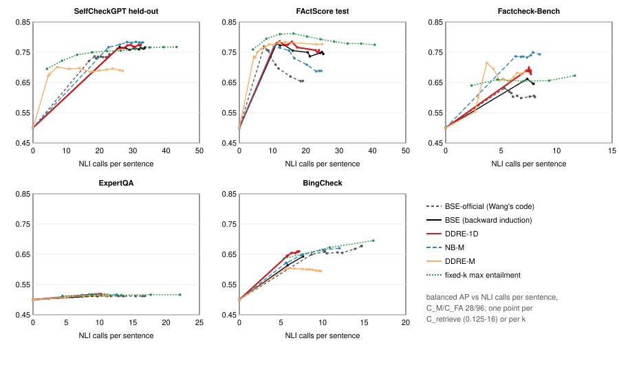

# Plan v2 — exploratory replay results (Phase 5)

**Status: exploratory.** All five datasets had been used before plan v2
(plan §1), so nothing here is confirmatory. The run follows
[`docs/research_plan_v2.md`](research_plan_v2.md) at amendment 1 and ran once
from clean `main` (`27075d8`). Every number below is generated from the frozen
result (§8).

All results concern **hallucination-detection performance** and its
computational cost.

---

## 1. What ran

**Methods.** Every method shares the documents, the prior, the update, the
min-over-subclaims aggregation and Wang's decision rule. They differ only in
the likelihood ratio.

- **Tier 1, Wang's NBC data (199 + 199 pairs):**
  - BSE: Wang's histogram;
  - DDRE-1D: uLSIF on entailment.
- **Tier 2, FActScore training entities (73,820 BM25 documents):**
  - Hist-1D;
  - DDRE-1D′;
  - NB-M: Naive-Bayes histograms on entailment, contradiction and rank;
  - DDRE-M: uLSIF on the same three features;
  - Logit-M.

**Stopping and settings:**
- All methods are stopped by **backward induction** over each subclaim's
  available documents (amendment 1).
- C_M/C_FA is 28/96 or 14/24. C_retrieve takes 15 log-spaced values from 0.125
  to 16; the operating point is 1.

**References:**
- BSE-official, Wang's released rule;
- the one-step Eq. 8;
- Wang's fixed-k baselines.

**Measures:**
- **Quality:** balanced average precision (AP).
- **Cost:** NLI calls per sentence.
- **Statistics:** paired cluster bootstrap, 10,000 replicates, seed 42.
- **Bold** marks a 95% interval that excludes 0 with no not-reached
  replicates.

**Gates** (all passed on all five datasets, 18,068 sentences):
- **X0:** pins.
- **X2:** BSE-official reproduces the frozen earlier replays row for row.
- **X3:** the engine's one-step Eq. 8 reads exactly `BSEDetector(eq8)`'s
  documents.

## 2. Cost–quality curves

Generated by `scripts/plot_v2_curves.py` from the frozen result.

**The curves have a cliff.**
- Under backward induction, most methods switch from reading nearly every
  document to reading none within a narrow C_retrieve range (between about
  1.4 and 2 on most datasets).
- The sweep therefore has no operating points at middle budgets. The lines
  from the origin are joins, not measurements.
- **Consequence:** the envelope endpoints E-quality and E-cost (§3, envelope table) compare a
  method's curve against points where the other curve has a gap. They are
  reported, but are hard to interpret.
- The operating-point comparisons and the AUC-gap are the more interpretable
  numbers here.
- This was found after the run. It is reported, not re-analysed.

## 3. Primary contrasts
#### DDRE-1D vs BSE, C_M/C_FA 28/96

| Dataset | BSE NLI, AP | DDRE-1D NLI, AP | NLI saved (op) | AP gain (op) | Brier reduction (op) | AUC-gap (curve) |
|---|---|---|---|---|---|---|
| SelfCheckGPT | 28.98, 0.758 | 28.40, 0.773 | **+0.58 [+0.25, +0.90]** | +0.015 [-0.002, +0.032] | -0.005 [-0.012, +0.002] | **+0.006 [+0.001, +0.011]** |
| FActScore test | 13.38, 0.775 | 13.32, 0.774 | +0.06 [-0.11, +0.25] | -0.000 [-0.019, +0.019] | **+0.011 [+0.001, +0.021]** | **+0.009 [+0.000, +0.019]** |
| Factcheck-Bench | 7.93, 0.646 | 7.50, 0.698 | **+0.43 [+0.31, +0.55]** | +0.053 [-0.002, +0.104] | **+0.034 [+0.018, +0.051]** | **+0.003 [+0.001, +0.007]** |
| ExpertQA | 10.89, 0.514 | 9.60, 0.518 | **+1.29 [+1.25, +1.32]** | +0.003 [-0.001, +0.008] | **+0.079 [+0.077, +0.082]** | **+0.002 [+0.001, +0.003]** |
| BingCheck | 5.81, 0.614 | 5.74, 0.645 | **+0.07 [+0.04, +0.11]** | **+0.031 [+0.022, +0.040]** | **+0.004 [+0.002, +0.007]** | **+0.010 [+0.008, +0.012]** |

#### DDRE-1D vs BSE, C_M/C_FA 14/24

| Dataset | BSE NLI, AP | DDRE-1D NLI, AP | NLI saved (op) | AP gain (op) | Brier reduction (op) | AUC-gap (curve) |
|---|---|---|---|---|---|---|
| SelfCheckGPT | 21.99, 0.763 | 22.90, 0.751 | **-0.91 [-1.37, -0.45]** | -0.012 [-0.031, +0.011] | **-0.013 [-0.020, -0.006]** | **-0.012 [-0.018, -0.005]** |
| FActScore test | 9.20, 0.760 | 9.41, 0.762 | **-0.21 [-0.36, -0.06]** | +0.002 [-0.021, +0.026] | **+0.011 [+0.001, +0.021]** | +0.002 [-0.006, +0.014] |
| Factcheck-Bench | 6.52, 0.657 | 6.69, 0.624 | -0.17 [-0.35, +0.00] | -0.033 [-0.076, +0.013] | **+0.024 [+0.007, +0.041]** | +0.002 [-0.008, +0.014] |
| ExpertQA | 11.19, 0.512 | 10.15, 0.516 | **+1.04 [+1.00, +1.08]** | **+0.004 [+0.001, +0.008]** | **+0.078 [+0.075, +0.080]** | **+0.001 [+0.000, +0.002]** |
| BingCheck | 8.40, 0.652 | 7.80, 0.665 | **+0.60 [+0.52, +0.68]** | **+0.013 [+0.005, +0.021]** | +0.000 [-0.003, +0.003] | **+0.021 [+0.018, +0.024]** |

#### DDRE-M vs NB-M, C_M/C_FA 28/96

| Dataset | NB-M NLI, AP | DDRE-M NLI, AP | NLI saved (op) | AP gain (op) | Brier reduction (op) | AUC-gap (curve) |
|---|---|---|---|---|---|---|
| SelfCheckGPT | 26.10, 0.775 | 13.91, 0.697 | **+12.19 [+11.10, +13.30]** | **-0.078 [-0.105, -0.050]** | **-0.037 [-0.050, -0.024]** | **+0.122 [+0.097, +0.150]** |
| FActScore test | 12.17, 0.765 | 7.73, 0.767 | **+4.45 [+4.00, +4.91]** | +0.002 [-0.023, +0.028] | **-0.037 [-0.051, -0.024]** | **+0.071 [+0.054, +0.090]** |
| Factcheck-Bench | 6.30, 0.736 | 4.84, 0.657 | **+1.45 [+1.01, +1.91]** | **-0.079 [-0.128, -0.028]** | **-0.127 [-0.163, -0.091]** | **+0.089 [+0.058, +0.126]** |
| ExpertQA | 7.36, 0.515 | 8.54, 0.512 | **-1.18 [-1.23, -1.12]** | -0.003 [-0.007, +0.001] | **-0.180 [-0.185, -0.176]** | +0.001 [-0.001, +0.003] |
| BingCheck | 0.00, 0.500 | 7.59, 0.602 | **-7.59 [-7.86, -7.33]** | **+0.102 [+0.085, +0.120]** | **-0.020 [-0.028, -0.014]** | **-0.014 [-0.020, -0.008]** |

#### DDRE-M vs NB-M, C_M/C_FA 14/24

| Dataset | NB-M NLI, AP | DDRE-M NLI, AP | NLI saved (op) | AP gain (op) | Brier reduction (op) | AUC-gap (curve) |
|---|---|---|---|---|---|---|
| SelfCheckGPT | 17.50, 0.765 | 8.66, 0.675 | **+8.84 [+7.91, +9.81]** | **-0.090 [-0.120, -0.061]** | **-0.031 [-0.045, -0.017]** | **+0.095 [+0.074, +0.122]** |
| FActScore test | 7.96, 0.762 | 4.83, 0.727 | **+3.13 [+2.86, +3.41]** | -0.035 [-0.069, +0.003] | **-0.071 [-0.089, -0.053]** | **+0.046 [+0.025, +0.067]** |
| Factcheck-Bench | 5.08, 0.737 | 2.71, 0.564 | **+2.37 [+2.04, +2.73]** | **-0.173 [-0.233, -0.108]** | **-0.139 [-0.178, -0.102]** | **+0.054 [+0.030, +0.084]** |
| ExpertQA | 8.80, 0.518 | 7.52, 0.508 | **+1.27 [+1.20, +1.35]** | **-0.010 [-0.015, -0.005]** | **-0.184 [-0.189, -0.180]** | +0.001 [-0.001, +0.003] |
| BingCheck | 7.31, 0.645 | 9.36, 0.585 | **-2.05 [-2.24, -1.86]** | **-0.060 [-0.075, -0.045]** | **-0.093 [-0.102, -0.084]** | -0.005 [-0.012, +0.002] |

"op" means the operating point (C_retrieve = 1); NLI saved > 0 means the
method is cheaper. AUC-gap is the mean AP difference over the shared cost
range of the two step envelopes.

**Tier 1 (the pure test: Wang's data, only the ratio estimator changed):**
- **At Wang's costs 28/96:**
  - At the same settings, DDRE-1D makes fewer NLI calls than BSE on all five
    datasets. The interval excludes 0 on four of them; the savings range from
    0.07 to 1.29 calls per sentence (1–12%).
  - Its AP is equal or higher: +0.031 on BingCheck, with intervals; +0.053 on
    Factcheck-Bench, whose interval reaches −0.002.
  - Brier improves on four datasets.
  - The AUC-gap is small but positive on all five.
- **At 14/24 the picture is mixed:**
  - Worse on SelfCheckGPT: 0.91 more NLI calls, AUC-gap −0.012.
  - Better on BingCheck and ExpertQA.
  - Mixed on FActScore and Factcheck-Bench: slightly more NLI calls, better
    Brier, no clear AP difference.
- **Effect size:** small throughout.

**Tier 2 (retriever-aware; DDRE-M vs its histogram control NB-M):**
- **Cost and quality trade off.** DDRE-M stops much earlier: 12.2 fewer NLI
  calls per sentence on SelfCheckGPT (47%), 4.4 on FActScore (37%) and 1.5 on
  Factcheck-Bench (23%). It pays in AP on SelfCheckGPT (−0.078) and on
  Factcheck-Bench (−0.079).
- **The curves agree.** DDRE-M is ahead at low budgets and behind at high
  budgets, which gives a positive AUC-gap on three datasets.
- **Calibration.** DDRE-M is worse calibrated on every dataset.
- **BingCheck.** NB-M reads nothing at the operating point (AP 0.5); DDRE-M
  reads 1.4 documents and reaches 0.602.

#### Envelope endpoints (28/96)

| Contrast | Dataset | E-quality | E-cost (NLI) |
|---|---|---|---|
| DDRE-1D vs BSE | SelfCheckGPT | +0.006 [-0.010, +0.021] | +0.65 [-2.62, +2.43] (n.r. 0%) |
| DDRE-1D vs BSE | FActScore test | +0.007 [-0.012, +0.022] | +0.53 [-2.47, +2.78] (n.r. 4%) |
| DDRE-1D vs BSE | Factcheck-Bench | +0.036 [-0.007, +0.081] | +0.08 [-0.04, +0.70] (n.r. 3%) |
| DDRE-1D vs BSE | ExpertQA | +0.003 [-0.001, +0.009] | +1.68 [+0.97, +2.12] (n.r. 5%) |
| DDRE-1D vs BSE | BingCheck | **+0.032 [+0.024, +0.041]** | **+0.11 [+0.08, +0.15]** |
| DDRE-M vs NB-M | SelfCheckGPT | **-0.074 [-0.098, -0.044]** | not reached (n.r. 100%) |
| DDRE-M vs NB-M | FActScore test | +0.013 [-0.013, +0.033] | +2.66 [-1.96, +6.48] (n.r. 2%) |
| DDRE-M vs NB-M | Factcheck-Bench | -0.022 [-0.071, +0.033] | not reached [-0.08, +3.10] (n.r. 76%) |
| DDRE-M vs NB-M | ExpertQA | -0.003 [-0.008, +0.001] | -3.97 [-4.03, +1.36] (n.r. 27%) |
| DDRE-M vs NB-M | BingCheck | +0.000 [+0.000, +0.000] | +0.00 [+0.00, +0.00] |

Read these with §2's caveat: "not reached" and large negative values arise
where one curve has no points between zero documents and its upper cluster.

## 4. Secondary contrasts

| Contrast (factor) | Dataset | AUC-gap | AP gain (op) | NLI saved (op) |
|---|---|---|---|---|
| DDRE-1D' vs Hist-1D (ratio estimator, one feature, larger data) | SelfCheckGPT | **+0.050 [+0.042, +0.060]** | +0.008 [-0.008, +0.023] | **+5.74 [+5.08, +6.42]** |
| DDRE-1D' vs Hist-1D (ratio estimator, one feature, larger data) | FActScore test | **+0.013 [+0.005, +0.023]** | +0.012 [-0.007, +0.030] | **+0.90 [+0.63, +1.21]** |
| DDRE-1D' vs Hist-1D (ratio estimator, one feature, larger data) | Factcheck-Bench | **+0.007 [+0.003, +0.013]** | +0.000 [+0.000, +0.000] | +0.00 [+0.00, +0.00] |
| DDRE-1D' vs Hist-1D (ratio estimator, one feature, larger data) | ExpertQA | **+0.001 [+0.001, +0.003]** | +0.000 [+0.000, +0.000] | +0.00 [+0.00, +0.00] |
| DDRE-1D' vs Hist-1D (ratio estimator, one feature, larger data) | BingCheck | **+0.001 [+0.000, +0.001]** | +0.000 [+0.000, +0.000] | +0.00 [+0.00, +0.00] |
| NB-M vs Hist-1D (features, histogram estimator) | SelfCheckGPT | **-0.027 [-0.037, -0.019]** | **+0.048 [+0.033, +0.065]** | **-7.93 [-9.17, -6.72]** |
| NB-M vs Hist-1D (features, histogram estimator) | FActScore test | +0.002 [-0.009, +0.013] | -0.016 [-0.038, +0.006] | **-0.79 [-0.99, -0.60]** |
| NB-M vs Hist-1D (features, histogram estimator) | Factcheck-Bench | **+0.016 [+0.009, +0.025]** | **+0.236 [+0.177, +0.304]** | **-6.30 [-6.96, -5.68]** |
| NB-M vs Hist-1D (features, histogram estimator) | ExpertQA | **-0.002 [-0.003, -0.001]** | **+0.015 [+0.010, +0.022]** | **-7.36 [-7.46, -7.27]** |
| NB-M vs Hist-1D (features, histogram estimator) | BingCheck | +0.000 [+0.000, +0.000] | +0.000 [+0.000, +0.000] | +0.00 [+0.00, +0.00] |
| DDRE-M vs DDRE-1D' (features, uLSIF estimator) | SelfCheckGPT | **+0.035 [+0.014, +0.058]** | **-0.037 [-0.063, -0.010]** | **-1.47 [-2.73, -0.25]** |
| DDRE-M vs DDRE-1D' (features, uLSIF estimator) | FActScore test | **+0.062 [+0.045, +0.081]** | **-0.025 [-0.049, -0.001]** | **+2.75 [+2.20, +3.30]** |
| DDRE-M vs DDRE-1D' (features, uLSIF estimator) | Factcheck-Bench | **+0.096 [+0.066, +0.136]** | **+0.157 [+0.100, +0.229]** | **-4.84 [-5.27, -4.45]** |
| DDRE-M vs DDRE-1D' (features, uLSIF estimator) | ExpertQA | -0.001 [-0.003, +0.001] | **+0.012 [+0.007, +0.020]** | **-8.54 [-8.65, -8.42]** |
| DDRE-M vs DDRE-1D' (features, uLSIF estimator) | BingCheck | **-0.002 [-0.004, -0.001]** | **+0.102 [+0.085, +0.120]** | **-7.59 [-7.86, -7.33]** |
| Hist-1D vs BSE (training data, histogram estimator) | SelfCheckGPT | **+0.058 [+0.047, +0.070]** | **-0.031 [-0.051, -0.012]** | **+10.81 [+9.49, +12.21]** |
| Hist-1D vs BSE (training data, histogram estimator) | FActScore test | +0.003 [-0.007, +0.010] | +0.006 [-0.010, +0.022] | **+2.00 [+1.72, +2.28]** |
| Hist-1D vs BSE (training data, histogram estimator) | Factcheck-Bench | **+0.017 [+0.010, +0.026]** | **-0.146 [-0.202, -0.101]** | **+7.93 [+7.26, +8.66]** |
| Hist-1D vs BSE (training data, histogram estimator) | ExpertQA | **+0.004 [+0.002, +0.006]** | **-0.014 [-0.021, -0.010]** | **+10.89 [+10.73, +11.05]** |
| Hist-1D vs BSE (training data, histogram estimator) | BingCheck | +0.000 [+0.000, +0.000] | **-0.114 [-0.130, -0.099]** | **+5.81 [+5.63, +6.00]** |
| DDRE-M vs Logit-M (direct-ratio family: uLSIF vs logistic) | SelfCheckGPT | **+0.108 [+0.085, +0.134]** | **-0.052 [-0.081, -0.023]** | **+6.90 [+5.92, +7.90]** |
| DDRE-M vs Logit-M (direct-ratio family: uLSIF vs logistic) | FActScore test | **+0.057 [+0.042, +0.076]** | **-0.029 [-0.055, -0.003]** | **+2.84 [+2.50, +3.18]** |
| DDRE-M vs Logit-M (direct-ratio family: uLSIF vs logistic) | Factcheck-Bench | **+0.112 [+0.079, +0.152]** | **+0.157 [+0.100, +0.229]** | **-4.84 [-5.27, -4.45]** |
| DDRE-M vs Logit-M (direct-ratio family: uLSIF vs logistic) | ExpertQA | **+0.003 [+0.001, +0.006]** | **+0.012 [+0.007, +0.020]** | **-8.54 [-8.65, -8.42]** |
| DDRE-M vs Logit-M (direct-ratio family: uLSIF vs logistic) | BingCheck | **+0.003 [+0.001, +0.004]** | **+0.102 [+0.085, +0.120]** | **-7.59 [-7.86, -7.33]** |
| BSE vs BSE-official (stopping rule: Wang's code vs backward induction) | SelfCheckGPT | **-0.062 [-0.076, -0.051]** | **+0.028 [+0.009, +0.046]** | **-10.04 [-10.90, -9.21]** |
| BSE vs BSE-official (stopping rule: Wang's code vs backward induction) | FActScore test | **-0.049 [-0.063, -0.034]** | **+0.019 [+0.001, +0.038]** | **-4.63 [-5.01, -4.26]** |
| BSE vs BSE-official (stopping rule: Wang's code vs backward induction) | Factcheck-Bench | **-0.032 [-0.048, -0.020]** | +0.031 [-0.013, +0.075] | **-2.01 [-2.35, -1.70]** |
| BSE vs BSE-official (stopping rule: Wang's code vs backward induction) | ExpertQA | +0.000 [-0.000, +0.000] | +0.003 [-0.001, +0.007] | **+0.31 [+0.26, +0.36]** |
| BSE vs BSE-official (stopping rule: Wang's code vs backward induction) | BingCheck | **+0.027 [+0.024, +0.032]** | **-0.046 [-0.058, -0.034]** | **+4.45 [+4.21, +4.70]** |

**Notes:**
- **Same-data, one-feature contrast** (Hist-1D → DDRE-1D′): the AUC-gap is
  positive on all five datasets. On ExpertQA, Factcheck-Bench and BingCheck
  both methods read nothing at the operating point.
- **Stopping rule** (BSE-official → BSE): backward induction reads more and
  scores higher at the operating point on SelfCheckGPT and FActScore. Wang's
  code rule spends its documents at a cheaper point.

## 5. A strong simple baseline: fixed-k maximum entailment

| Dataset | BSE-official NLI, AP | DDRE-1D NLI, AP | best fixed-k max at ≤ DDRE-1D's NLI | best fixed-k overall |
|---|---|---|---|---|
| SelfCheckGPT | 18.94, 0.730 | 28.40, 0.773 | max@6: 26.37, 0.755 | nbc@8: 35.01, 0.774 |
| FActScore test | 8.74, 0.755 | 13.32, 0.774 | max@3: 12.19, 0.810 | max@4: 16.25, 0.812 |
| Factcheck-Bench | 5.92, 0.615 | 7.50, 0.698 | max@2: 4.66, 0.660 | avg@5: 11.64, 0.677 |
| ExpertQA | 11.20, 0.512 | 9.60, 0.518 | max@2: 8.84, 0.515 | avg@5: 22.08, 0.517 |
| BingCheck | 10.26, 0.660 | 5.74, 0.645 | max@1: 5.37, 0.636 | max@3: 16.10, 0.695 |

**Reading the first k documents and taking the maximum entailment** (Wang's
Figure 2 "Maximum" baseline) matches or beats BSE-official at equal or lower
NLI cost on four of the five datasets:
- On FActScore it reaches AP 0.795 at 8.1 calls, against BSE-official's 0.755
  at 8.7.
- It also matches or beats DDRE-1D at equal cost on FActScore, but not on
  SelfCheckGPT or Factcheck-Bench.

Wang's Figure 2 compares BSE with fixed k on passage-level Spearman on
SelfCheckGPT only. Our comparison is sentence-level AP on five datasets. The
fixed-k scores were not bootstrapped (observed values only).

## 6. The stopping rules

| Dataset | BSE-official | BSE (backward induction) | BSE-eq8 | DDRE-1D-eq8 | DDRE-M-eq8 |
|---|---|---|---|---|---|
| SelfCheckGPT | 6.37 | 9.98 | 0.00 | 0.00 | 2.40 |
| FActScore test | 8.74 | 13.38 | 0.00 | 0.00 | 5.94 |
| Factcheck-Bench | 5.92 | 7.93 | 0.00 | 0.00 | 4.13 |
| ExpertQA | 11.20 | 10.89 | 0.00 | 0.00 | 6.08 |
| BingCheck | 1.91 | 1.09 | 0.00 | 0.00 | 1.12 |

The one-step Eq. 8 reads nothing for every method except DDRE-M, whose
extreme log ratios can flip a decision in one document. This confirms
amendment 1's finding on every dataset.

## 7. What this says about the goals (exploratory)

| Goal | Tier 1 (only the ratio changed, Wang's data) | Tier 2 (retriever-aware) |
|---|---|---|
| **G1, cost** | at 28/96, slightly fewer NLI calls than BSE on all five datasets at equal or better AP; at 14/24 more calls on SelfCheckGPT and FActScore | much cheaper than its histogram control, at a quality cost on two datasets |
| **G2, detection** | small, mostly positive AUC-gaps; one clear gain at the operating point (BingCheck +0.031) | better at low budgets, worse at high budgets |
| **G3, calibration** | better Brier on four of five datasets at 28/96 | worse on every dataset |

**Other findings:**
- A simple fixed-k maximum-entailment baseline is competitive with every
  sequential method, and better than Wang's BSE on several datasets. Any cost
  claim must be made against it.
- ExpertQA carries almost no signal for any method (AP ≈ 0.51).

## 8. Limitations

- **Exploratory:** every dataset was used before.
- **Cliff (§2):** the C_retrieve sweep does not cover middle budgets under
  backward induction, so envelope endpoints are hard to interpret.
- **Training data:** Tier 1's 398 NBC pairs are whole premises, while test
  documents are scored as the maximum over spans (`docs/wang_deviations.md`
  row 11, D-13).
- **Rank** means a different retriever on each dataset.
- **Fixed-k scores:** observed only.
- **Wall-clock time:** not measured (Phase 6).

## 9. Run record and artifacts

The run was made from `27075d8`, with plan v2 at amendment 1
(`88e29ec6…`). All artifacts below are read-only.

| Artifact | sha256 |
|---|---|
| `~/ddre-artifacts/v2/estimators_v2_float16.json` | `6a007e379a3fc84fabb6d367ede41a3c81c53accc4f7f86b0a29e2ec546fadec` |
| `~/ddre-artifacts/v2/v2_replay_result_float16.json` | `a7fe078169b0625eddffb8991bdd52b113c499ffb26a77b63bcafb9c2531af93` |
| `~/ddre-artifacts/v2/v2_replay_predictions_float16.csv` | `bd75f4864ee72695c8e95bb3791daea126d6496d78e3f329e7a34a41db32feb5` |
| `docs/figures/v2_cost_quality_curves.svg` | `d70ecd48b16b880e472a5615a547d11c68a646e4e00b31a59b595a474d872ad7` |
